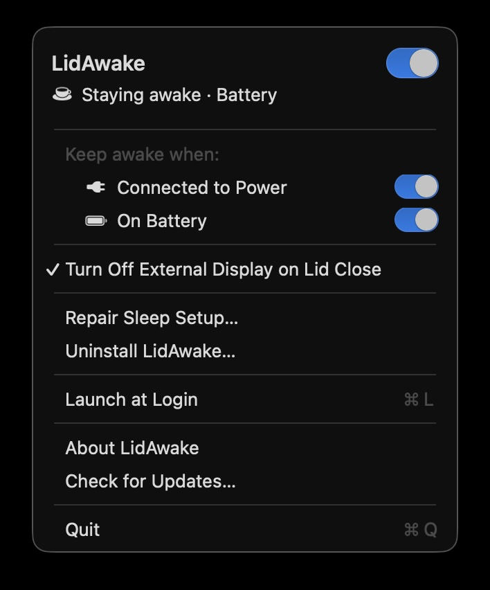

# LidAwake

**Close your MacBook lid and keep working.** A tiny macOS menu bar app that stops your
Mac from sleeping on lid close — so **Claude Code**, **Codex**, builds, downloads, and
other long-running terminal jobs keep running with the laptop shut. No external display needed.

A focused, closed-lid alternative to **Amphetamine** / **Caffeine**.



## Why

- macOS sleeps the instant you close the lid → your task dies mid-run.
- Clamshell mode needs an external monitor + keyboard you don't always have.
- LidAwake keeps the Mac awake lid-closed *and* switches the internal screen off, so nothing's wasted.

## Features

- **LidAwake switch** — pause or resume sleep prevention without clearing your AC, battery, or display preferences. The choice survives relaunches.
- ☕ / 🌙 **menu bar status** — staying awake vs. sleep enabled, at a glance.
- **Per power source** — independent AC and battery policies; auto-applied on plug/unplug.
- **Screen off when closed** — blanks the internal panel on lid close, and the external monitor too (uncheck the toggle to keep clamshell mode and leave the external on).
- **Launch at Login** (`⌘L`) — starts the installed copy, including outside `/Applications`.
- **Sleep restoration** — quitting restores the app's sleep override; a background worker also restores it if the menu app crashes.
- **Manual update checks** — “Check for Updates…” checks [GitHub Releases](https://github.com/TurboKach/LidAwake/releases) and offers the newer release page.
- **Developer credits** — “About LidAwake” credits [TurboKach](https://github.com/TurboKach) and links to the source.
- Readable live status below the master switch, e.g. *“Sleep enabled · Battery”*.

Use the **LidAwake** switch at the top of the menu as the master control (`⌘E` while the
menu is open), then switch **Connected to Power** and/or
**On Battery** on under **Keep awake when:**. These two rows are switches, and the menu
stays open when you change them; click outside it to close it. With only AC switched on,
unplugging allows sleep and reconnecting keeps the Mac awake again. Turning the master off
restores sleep, stops LidAwake's display blanking, and dims the dependent controls while
keeping their selections. Setup, login, and update actions remain available. The master is
on only while at least one condition is on: switching off the last one turns the master off,
and turning the master on with none on switches both on. A fresh install starts with the
master off and both conditions on. Existing installs retain their saved power-source choices, and a setup
that keeps the Mac awake today stays that way after the upgrade.

## How it works

Toggles `pmset disablesleep` (`0` = sleep, `1` = stay awake) — one live, system-wide
value, so LidAwake watches power changes and applies your per-source policy itself. It
reads the value from `pmset -g`; on macOS 27, where that output no longer lists
`SleepDisabled`, it reads the same value from the `IOPMrootDomain` registry entry. A
single background worker owns these writes. On lid
close it runs `pmset displaysleepnow` to blank the internal screen — and the external one
too, unless you keep clamshell mode on. Requires **macOS 12+**.

> [!NOTE]
> Keeping a Mac awake lid-closed in a bag can get warm and drain the battery. Keep it
> ventilated; prefer AC-only if unsure.

## Install

1. Download `LidAwake.dmg` from [Releases](../../releases), open it, drag **LidAwake** → **Applications**.
2. It's unsigned, so the first launch is Gatekeeper-blocked. Either:
   - Open it → click **Done** (*not* Move to Trash) → **System Settings → Privacy & Security → Open Anyway**, or
   - run `xattr -dr com.apple.quarantine /Applications/LidAwake.app`

**First run** offers a scoped passwordless rule at `/etc/sudoers.d/lidawake-<your UID>`
(the administrator password dialog explains this in LidAwake's own words, English or Russian).
It allows exactly `/usr/bin/pmset -a disablesleep 0` and `... disablesleep 1`, validated
with `visudo`. Setup is required before enabling keep-awake so crash recovery can restore
sleep without a password prompt. “Not Now” leaves keep-awake unavailable; setup remains
accessible from the menu. “Repair Sleep Setup…” also migrates the old wildcard rule,
preserving its account while narrowing its permissions.

Quit the old app before running an updated copy. Only one new LidAwake session can own
sleep control at a time. Avoid using another `disablesleep` manager concurrently.

If restoring sleep fails, Quit offers to stay open and repair setup. If the menu app
crashes, the worker restores sleep independently. If both processes die, or permission
is revoked, a private recovery marker survives and restoration is retried on next launch.
This cannot guarantee immediate restoration after both processes fail. The menu reports
failed changes and unavailable status instead of treating a failed read as sleep enabled.

To uninstall, choose “Uninstall LidAwake…” from the menu. It restores sleep, removes
`/etc/sudoers.d/lidawake-<uid>` and the legacy `/etc/sudoers.d/lidawake` after one admin
prompt (the legacy rule only if it names your account; otherwise it is left in place and
LidAwake says so), turns off Launch at Login, deletes its settings and
`~/Library/Application Support/LidAwake`, moves the app to the Trash, and quits. Canceling
the admin prompt removes nothing; if a step fails, LidAwake stops there and lists what remains.

To uninstall manually instead, quit LidAwake first, confirm sleep is enabled, then remove its rule with
`sudo rm "/etc/sudoers.d/lidawake-$(id -u)"`. An older installation may also have
`/etc/sudoers.d/lidawake`; remove that only if it is no longer used by another account.
If necessary, restore sleep manually with `sudo pmset -a disablesleep 0`.

## Build

```sh
./build.sh                 # compile + bundle + install to /Applications
./build.sh --no-install    # build a local app without installing
swift test                # regression tests with simulated power settings
./release.sh              # universal (arm64 + Intel) LidAwake.dmg
./scripts/check-build.sh universal  # verify the universal bundle and macOS 12 target
```

Both build paths use `Package.swift` for the macOS 12 deployment target and `Info.plist`
for bundle metadata. Before publishing a new release, increment `CFBundleShortVersionString`
and `CFBundleVersion` in `Info.plist`; use a corresponding GitHub release tag such as
`v1.2.0`. The update checker compares numeric stable versions, accepts an optional `v`
prefix, and never downloads or installs anything automatically. It contacts GitHub only
when you choose “Check for Updates…”.

The macOS CI workflow runs regression tests and verifies both architectures. See
[manual validation](docs/testing.md) for checks that require a real MacBook and displays.
The keep-awake lease integration in `docs/prompts/` remains a future feature.

## Credits

Developed by [TurboKach](https://github.com/TurboKach).
Source and releases: [TurboKach/LidAwake](https://github.com/TurboKach/LidAwake).
